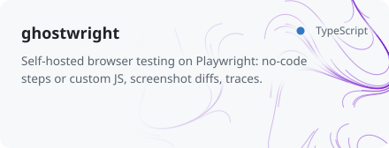
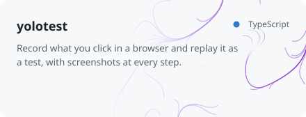
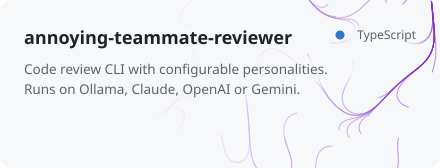
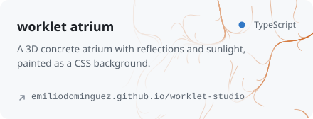
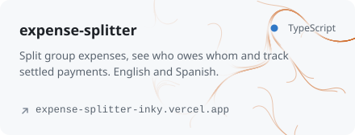

<!-- Generated by scripts/generate.mjs from projects.json. Edit those, not this file. -->

<picture><source media="(prefers-color-scheme: dark)" srcset="assets/banner-dark.svg"></picture>

[npm](https://www.npmjs.com/~emidominguez) · [X](https://x.com/emi__dominguez)

### npm packages

<a href="https://github.com/emiliodominguez/lumenql"><picture><source media="(prefers-color-scheme: dark)" srcset="assets/cards/lumenql-dark.svg"></picture></a>
<a href="https://github.com/emiliodominguez/rsc-state"><picture><source media="(prefers-color-scheme: dark)" srcset="assets/cards/rsc-state-dark.svg"></picture></a>
<a href="https://github.com/emiliodominguez/tinkit"><picture><source media="(prefers-color-scheme: dark)" srcset="assets/cards/tinkit-dark.svg"></picture></a>
<a href="https://github.com/emiliodominguez/pixelguard"><picture><source media="(prefers-color-scheme: dark)" srcset="assets/cards/pixelguard-dark.svg"></picture></a>
<a href="https://github.com/emiliodominguez/repo-song"><picture><source media="(prefers-color-scheme: dark)" srcset="assets/cards/repo-song-dark.svg"></picture></a>
<a href="https://github.com/emiliodominguez/worklet-studio"><picture><source media="(prefers-color-scheme: dark)" srcset="assets/cards/worklet-studio-dark.svg"></picture></a>

Also co-maintained on npm: [@berenjena/react-dev-panel](https://github.com/Berenjenas/react-dev-panel) and [cococh](https://github.com/dallegos/cococh).

### Agent skills

<a href="https://github.com/emiliodominguez/flow-skills"><picture><source media="(prefers-color-scheme: dark)" srcset="assets/cards/flow-skills-dark.svg"></picture></a>
<a href="https://github.com/emiliodominguez/test-skills"><picture><source media="(prefers-color-scheme: dark)" srcset="assets/cards/test-skills-dark.svg"></picture></a>
<a href="https://github.com/emiliodominguez/threejs-skills"><picture><source media="(prefers-color-scheme: dark)" srcset="assets/cards/threejs-skills-dark.svg"></picture></a>

### CLIs and tools

<a href="https://github.com/emiliodominguez/sass-dep"><picture><source media="(prefers-color-scheme: dark)" srcset="assets/cards/sass-dep-dark.svg"></picture></a>
<a href="https://github.com/emiliodominguez/ghostwright"><picture><source media="(prefers-color-scheme: dark)" srcset="assets/cards/ghostwright-dark.svg"></picture></a>
<a href="https://github.com/emiliodominguez/yolotest"><picture><source media="(prefers-color-scheme: dark)" srcset="assets/cards/yolotest-dark.svg"></picture></a>
<a href="https://github.com/emiliodominguez/annoying-teammate-reviewer"><picture><source media="(prefers-color-scheme: dark)" srcset="assets/cards/annoying-teammate-reviewer-dark.svg"></picture></a>

### In the browser

<a href="https://emiliodominguez.github.io/web-audio-api-synth/"><picture><source media="(prefers-color-scheme: dark)" srcset="assets/cards/web-audio-api-synth-dark.svg"></picture></a>
<a href="https://emiliodominguez.github.io/worklet-studio/atrium.html"><picture><source media="(prefers-color-scheme: dark)" srcset="assets/cards/worklet-atrium-dark.svg"></picture></a>
<a href="https://github.com/emiliodominguez/agents-camp"><picture><source media="(prefers-color-scheme: dark)" srcset="assets/cards/agents-camp-dark.svg"></picture></a>
<a href="https://expense-splitter-inky.vercel.app"><picture><source media="(prefers-color-scheme: dark)" srcset="assets/cards/expense-splitter-dark.svg"></picture></a>
